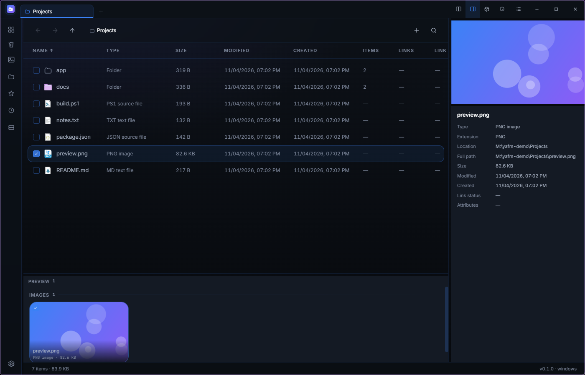
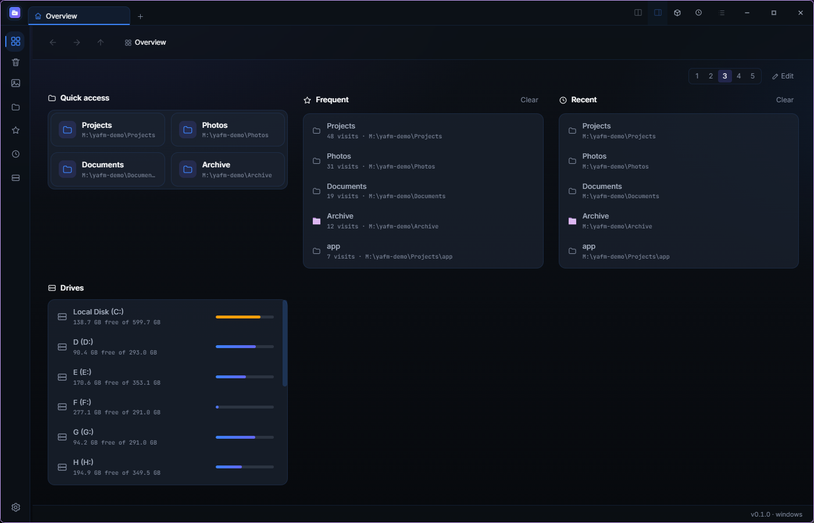
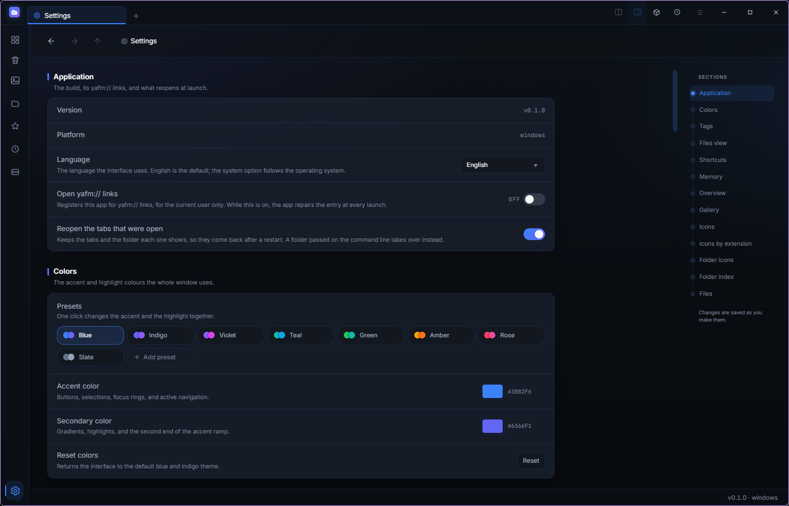

<div align="center">
  
  <h1>Yet Another File Manager</h1>
  <p><strong>すべてを 1 つのウィンドウにまとめるファイルマネージャー。</strong></p>
  <p>
    <a href="https://t2penbix99wcoxkv3a4g.github.io/Yet-Another-File-Manager/">ウェブサイト</a> ·
    <a href="https://t2penbix99wcoxkv3a4g.github.io/Yet-Another-File-Manager/#/docs/Getting-Started">ドキュメント</a>
  </p>
  <p>
    <a href="README.md">English</a> ·
    <a href="README.zh-CN.md">简体中文</a> ·
    <a href="README.zh-TW.md">繁體中文</a>
  </p>
</div>

タブ、プレビュー、アーカイブ、タグ、ギャラリーを 1 つのウィンドウにまとめたデスクトップ向けファイルマネージャーです。

<div align="center">
  <a href="docs/main-window.png"></a>
  <br>
  <em>メインウィンドウ（詳細パネル付き）</em>
  <br><br>
  <a href="docs/overview.png"></a>
  <br>
  <em>概要</em>
  <br><br>
  <a href="docs/settings.png"></a>
  <br>
  <em>設定: カラープリセット、セクション一覧</em>
</div>

## できること

- **タブと分割表示** — 複数のフォルダーを同時に開き、2 つを並べて表示。タブごとに履歴を持ちます。
- **リストとグリッド** — 任意の列で並べ替え、列を選び、見出しをドラッグして幅を変更。フォルダーごとに
  表示を記憶します。
- **プレビュー** — 画像、動画、PDF、テキストをリストの横または下に表示。選択項目のサイズ、日時、
  リンク先、属性も出ます。
- **アーカイブ** — ZIP、7z、RAR、TAR と 7-Zip が読める形式をフォルダーとして開けます。分割ボリュームや
  パスワード付きも同様。ZIP・7z・TAR の作成では AES と分割、ZIP では圧縮方式も選べます。
- **概要** — クイックアクセス、よく使う、最近、ドライブ、共有、お気に入り、任意のフォルダーを
  1〜5 列のパネルで。
- **検索とタグ** — 入力に合わせて絞り込む検索バー（大文字小文字の区別、正規表現）。タグは全体で 1 つの
  一覧で、色も共通です。
- **ギャラリー** — 指定したフォルダーの画像を日付ごとにまとめ、ダブルクリックで原寸表示。
- **ごみ箱** — 元に戻す、完全に削除、ファイルが既にない記録の整理。
- **ファイル操作はアプリ内で** — コピー、移動、名前の変更、削除をアプリが実行し、進捗を表示して
  ごみ箱の記録も自分で書きます。履歴から元に戻せます。
- **共有** — ペアリングした端末のアプリへ、または同じネットワークのブラウザーへフォルダーを公開。
- **速さ** — フォルダーごとの小さなインデックス（または中央データベース）、遅延読み込みのアイコン、
  まとまった処理を受け持つ Rust ヘルパー。
- **切り取りと貼り付け** — トレイにクリップボードの中身と、貼り付けで移動される項目が表示されます。

## 使っているもの

- **C# / .NET 10** — ファイル操作、シェル連携、ごみ箱、アイコン、SQLite インデックス、トレイ。
- **React 19 + TypeScript**（**Vite**、**styled-components**） — インターフェース。表示のみを担当し、
  C# 側と JSON メッセージでやり取りします。
- **Photino.NET** — デスクトップシェル。Web ビューは OS のものを使います（Windows は WebView2、
  Linux は WebKitGTK）。
- **Rust**（`Native/yafm-native`） — ギャラリーの走査、アーカイブ作成（ZIP と 7z）、ツリーの計測と
  削除。ビルドの一部で、cargo がないとビルドが止まり、ライブラリがないとアプリは起動しません。

## インストール

公開ビルドは自己完結で、.NET ランタイムを同梱しています。必要なのは Web ビューと、Linux では
トレイ用ライブラリだけです。

| ファイル | 対象 |
| --- | --- |
| `YetAnotherFileManager-<version>-win-x64.msi` | Windows（ユーザー単位、管理者権限不要） |
| `yafm-<version>-1.fcXX.x86_64.rpm` | Fedora — `sudo dnf install ./yafm-<version>-*.rpm` |
| `yafm_<version>_amd64.deb` | Debian / Ubuntu — `sudo apt install ./yafm_<version>_amd64.deb` |
| `yafm-<version>-1-x86_64.pkg.tar.zst` | Arch — `sudo pacman -U yafm-<version>-1-x86_64.pkg.tar.zst` |

Windows 10/11 には WebView2 が入っています。コード署名はしていないため、初回に SmartScreen の警告が
出ることがあります。Linux は WebKitGTK 4.1 と libnotify が必要で、Fedora + KDE Plasma（Wayland）で
動作確認しています。クリップボードは Wayland では wl-clipboard、X11 では xclip を使います。

スクリプトからはシェルのダイアログの代わりに同じピッカーを使えます。

```bash
yafm --pick-folder [--multiple] [--initial <path>] [--output <file>]
yafm --pick-file --filter "*.png;*.jpg" [--multiple] [--initial <path>] [--output <file>]
```

選んだパスは 1 行ずつ標準出力に出ます。キャンセル時は終了コード `1` です。

## ビルド

```bash
git clone https://github.com/T2PeNBiX99wcoxKv3A4g/Yet-Another-File-Manager.git
cd YetAnotherFileManager
dotnet build YetAnotherFileManager/YetAnotherFileManager.csproj   # cargo も実行されます
```

インターフェースは別の Vite プロジェクトです。

```bash
cd YetAnotherFileManager/UserInterface
npm install
npm run build     # Resources/wwwroot に出力（Release ビルドが配信）
npm run dev       # Debug ビルドはこちらに接続: http://127.0.0.1:3100
```

cargo は必須で、ないとビルドが止まります。ウェブサイトとドキュメントは `Site` にあります。

```bash
cd Site
npm install
npm run dev
```

## クレジット

- [Sigma File Manager](https://github.com/aleksey-hoffman/sigma-file-manager)（Aleksey Hoffman） —
  レイアウトと機能構成の初期の参考。

## ライセンス

MIT — [LICENSE](LICENSE) を参照。
