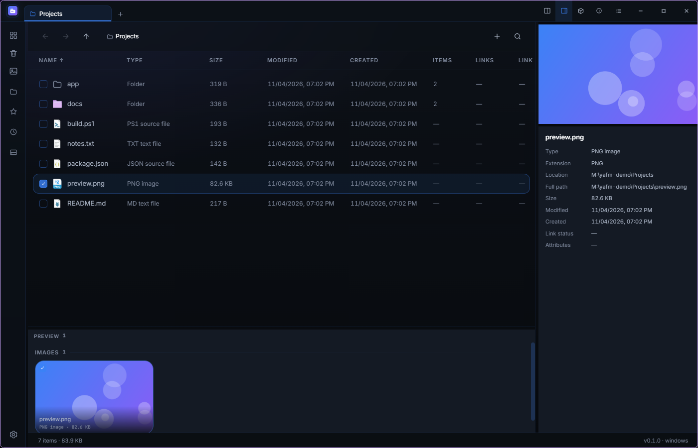
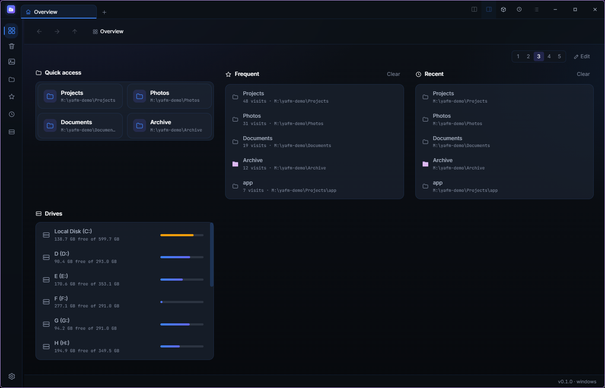
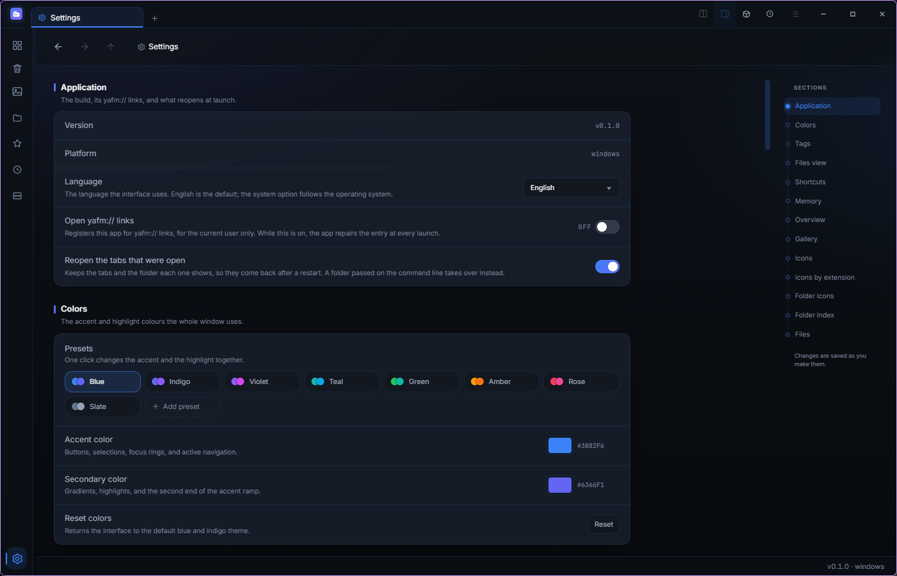

<div align="center">
  
  <h1>Yet Another File Manager</h1>
  <p><strong>A file manager that keeps everything in one window.</strong></p>
  <p>
    <a href="https://t2penbix99wcoxkv3a4g.github.io/Yet-Another-File-Manager/">Website</a> ·
    <a href="https://t2penbix99wcoxkv3a4g.github.io/Yet-Another-File-Manager/#/docs/Getting-Started">Documentation</a>
  </p>
  <p>
    <a href="README.ja.md">日本語</a> ·
    <a href="README.zh-CN.md">简体中文</a> ·
    <a href="README.zh-TW.md">繁體中文</a>
  </p>
</div>

A desktop file manager with tabs, previews, archives, tags and a gallery in one window.

<div align="center">
  <a href="docs/main-window.png"></a>
  <br>
  <em>The main window, with the details panel</em>
  <br><br>
  <a href="docs/overview.png"></a>
  <br>
  <em>The overview</em>
  <br><br>
  <a href="docs/settings.png"></a>
  <br>
  <em>Settings: colour presets and the section list</em>
</div>

## What it does

- **Tabs and split view** — several folders at once, two side by side, each tab with its own history.
- **List and grid** — sort by any column, pick the columns, drag a header to resize it, and let each
  folder remember its own layout.
- **Previews** — pictures, video, PDFs and text beside or under the list, with the selection's size,
  dates, link target and attributes.
- **Archives** — open ZIP, 7z, RAR, TAR and the formats 7-Zip reads as folders, split volumes and
  passwords included; create ZIP, 7z or TAR, with AES and volumes, and a choice of method for ZIP.
- **Overview** — a home page of panels: quick access, frequent, recent, drives, shared, favourites and
  any folder, in one to five columns.
- **Search and tags** — a filter bar with match case and regular expressions; one global tag
  catalogue with a colour per tag.
- **Gallery** — the folders you point it at, grouped by day, opened at full size on double click.
- **Recycle bin** — restore, delete for good, or clear the records whose files are already gone.
- **File operations in the app** — copy, move, rename and delete run in-process, report progress and
  write the recycle bin entry themselves; the history can undo them.
- **Sharing** — offer a folder to paired devices in this app, or to any browser on the network.
- **Fast** — a small index per folder (or one central database), lazy shell icons, and a Rust helper
  for the bulk work.
- **Cut and paste** — the tray shows what is on the clipboard and which entries a paste will move.

## What it is built with

- **C# on .NET 10** — the file system work, shell integration, trash, icons, the SQLite index and the
  tray.
- **React 19 + TypeScript**, bundled by **Vite** and styled with **styled-components** — the
  interface. It is presentation only and exchanges JSON messages with the C# side.
- **Photino.NET** — the desktop shell. The web view comes from the system: WebView2 on Windows,
  WebKitGTK on Linux.
- **Rust** (`Native/yafm-native`) — the gallery scan, archive creation (ZIP and 7z) and measuring or
  deleting a tree. It is part of the build: cargo compiles it, the build fails without it, and the app
  does not start without the library.

## Install

Published builds are self-contained: the .NET runtime is inside. Only the web view, and the tray
library on Linux, have to be there.

| File | For |
| --- | --- |
| `YetAnotherFileManager-<version>-win-x64.msi` | Windows, per user, no administrator rights |
| `yafm-<version>-1.fcXX.x86_64.rpm` | Fedora — `sudo dnf install ./yafm-<version>-*.rpm` |
| `yafm_<version>_amd64.deb` | Debian / Ubuntu — `sudo apt install ./yafm_<version>_amd64.deb` |
| `yafm-<version>-1-x86_64.pkg.tar.zst` | Arch — `sudo pacman -U yafm-<version>-1-x86_64.pkg.tar.zst` |

Windows 10 and 11 already have WebView2; the build is not code-signed, so SmartScreen may warn once.
Linux needs WebKitGTK 4.1 and libnotify, and is tested on Fedora with KDE Plasma on Wayland. The
clipboard uses wl-clipboard on Wayland or xclip on X11.

Scripts can use the same picker instead of a shell dialog:

```bash
yafm --pick-folder [--multiple] [--initial <path>] [--output <file>]
yafm --pick-file --filter "*.png;*.jpg" [--multiple] [--initial <path>] [--output <file>]
```

The chosen paths go to standard output, one per line. Cancelling exits with `1`.

## Build

```bash
git clone https://github.com/T2PeNBiX99wcoxKv3A4g/Yet-Another-File-Manager.git
cd YetAnotherFileManager
dotnet build YetAnotherFileManager/YetAnotherFileManager.csproj   # runs cargo as well
```

The interface is its own Vite project:

```bash
cd YetAnotherFileManager/UserInterface
npm install
npm run build     # writes Resources/wwwroot, which a Release build serves
npm run dev       # a Debug build talks to this: http://127.0.0.1:3100
```

Cargo is required; the build stops without it. The website and its documentation live in `Site`:

```bash
cd Site
npm install
npm run dev
```

## Credits

- [Sigma File Manager](https://github.com/aleksey-hoffman/sigma-file-manager) by Aleksey Hoffman —
  an early design reference for the layout and the feature set.

## License

MIT — see [LICENSE](LICENSE).
