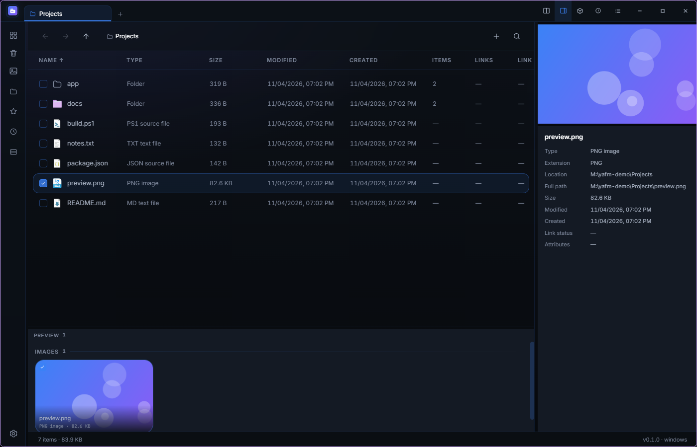
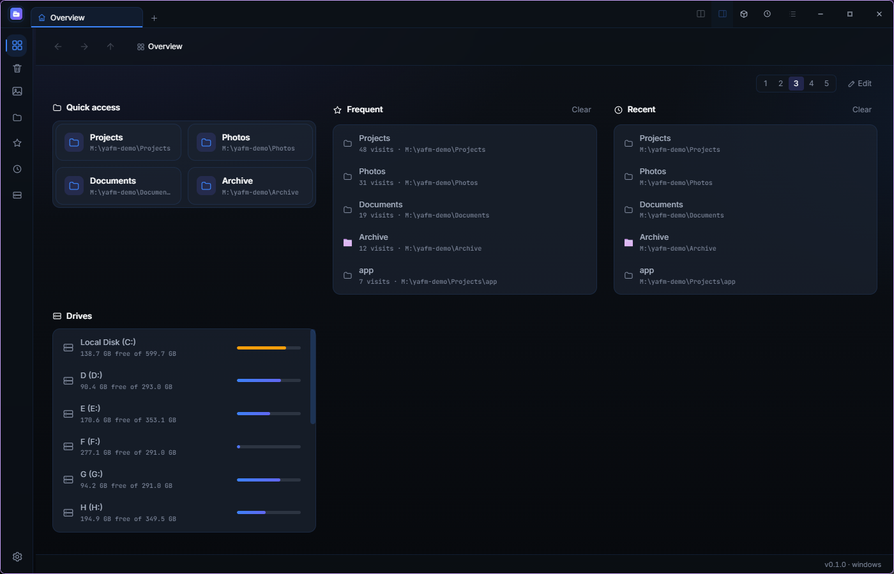
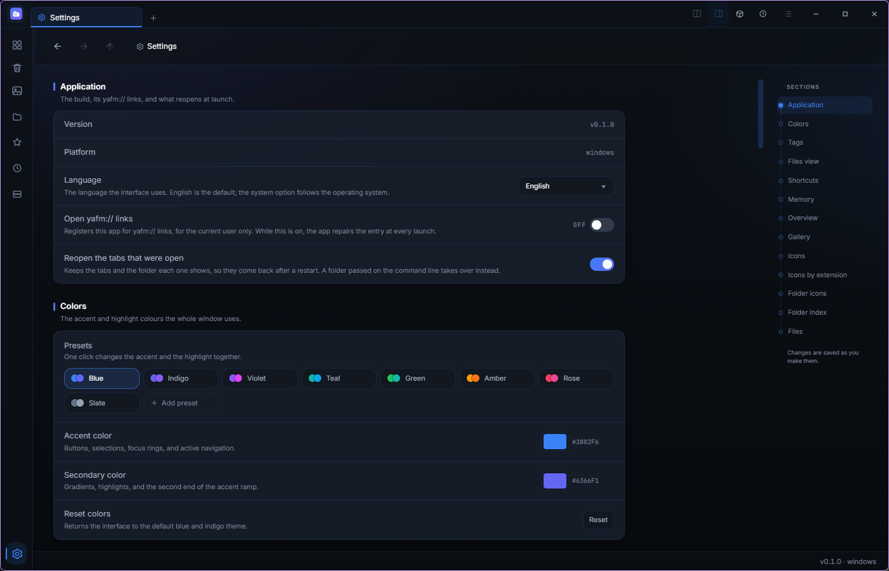

<div align="center">
  
  <h1>Yet Another File Manager</h1>
  <p><strong>把所有东西放进一个窗口的文件管理器。</strong></p>
  <p>
    <a href="https://t2penbix99wcoxkv3a4g.github.io/Yet-Another-File-Manager/">网站</a> ·
    <a href="https://t2penbix99wcoxkv3a4g.github.io/Yet-Another-File-Manager/#/docs/Getting-Started">文档</a>
  </p>
  <p>
    <a href="README.md">English</a> ·
    <a href="README.ja.md">日本語</a> ·
    <a href="README.zh-TW.md">繁體中文</a>
  </p>
</div>

标签页、压缩包、标签和图库都在同一个窗口里的桌面文件管理器。

<div align="center">
  <a href="docs/main-window.png"></a>
  <br>
  <em>主窗口，带详细信息面板</em>
  <br><br>
  <a href="docs/overview.png"></a>
  <br>
  <em>概览</em>
  <br><br>
  <a href="docs/settings.png"></a>
  <br>
  <em>设置：颜色预设与分区列表</em>
</div>

## 其他软件没有的

- **分屏** — 多个文件夹以标签页打开，两个并排显示；每个标签页有自己的历史记录。
- **概览** — 由面板组成的主页：快速访问、常用、最近、驱动器、共享、收藏和任意文件夹，一到五列。
- **标签** — 只有一个全局目录：在任何文件夹里都能给文件和文件夹打标签，每个标签一种颜色；改名或
  改色会一次性作用到所有文件夹。
- **图库** — 把指定文件夹里的图片按日期分组，双击即可原尺寸查看。
- **压缩包** — 把 ZIP、7z、RAR、TAR 以及 7-Zip 能读的格式当作文件夹打开，分卷和加密的也一样；创建
  ZIP、7z、TAR 时可指定 AES 与分卷，ZIP 还可选择压缩方式。
- **共享** — 把文件夹提供给已配对的设备，或同一网络中的任何浏览器。
- **回收站** — 还原、永久删除，还能看到其他用户的回收站里剩下的东西。
- **操作历史** — 状态中心列出本次会话做过的操作，任意一条都能撤销。
- **文件托盘** — 用来暂存马上要粘贴的东西的架子：可以把任何文件夹里选中的项目拖上去，它也会同步系统
  剪贴板，其他应用里复制的内容同样会出现在这里。
- **搜索** — 区分大小写、正则表达式，输入时把其余项目变暗或隐藏。
- **给脚本用的选择器** — 用 `yafm --pick-folder` / `--pick-file` 代替系统对话框。
- **速度** — 每个文件夹的小型索引（或一个中央数据库）、延迟加载的图标，以及处理批量工作的 Rust 辅助程序。

## 用了什么

- **C# / .NET 10** — 文件操作、Shell 集成、回收站、图标、SQLite 索引和托盘图标。
- **React 19 + TypeScript**（ **Vite**、 **styled-components**） — 界面。只负责显示，通过 JSON 消息与
  C# 端通信。
- **Photino.NET** — 桌面外壳。Web 视图来自系统：Windows 用 WebView2，Linux 用 WebKitGTK。
- **Rust**（`Native/yafm-native`） — 图库扫描、创建压缩包（ZIP 与 7z）、测量和删除目录树。它是构建的
  一部分：没有 cargo 构建会停止，缺少库应用无法启动。

## 安装

发布版本自带 .NET 运行时，除了 Web 视图（以及 Linux 的托盘库）外不需要安装别的东西。

| 文件                                          | 适用                                                            |
|-----------------------------------------------|-----------------------------------------------------------------|
| `YetAnotherFileManager-<version>-win-x64.msi` | Windows（按用户安装，无需管理员权限）                           |
| `yafm-<version>-1.fcXX.x86_64.rpm`            | Fedora — `sudo dnf install ./yafm-<version>-*.rpm`              |
| `yafm_<version>_amd64.deb`                    | Debian / Ubuntu — `sudo apt install ./yafm_<version>_amd64.deb` |
| `yafm-<version>-1-x86_64.pkg.tar.zst`         | Arch — `sudo pacman -U yafm-<version>-1-x86_64.pkg.tar.zst`     |

Windows 10/11 自带 WebView2；构建没有代码签名，首次运行时 SmartScreen 可能提示一次。Linux 需要
WebKitGTK 4.1 和 libnotify，目前在 Fedora + KDE Plasma（Wayland）上测试。剪贴板在 Wayland 使用
wl-clipboard，在 X11 使用 xclip。

脚本可以用同一个选择器代替系统对话框：

```bash
yafm --pick-folder [--multiple] [--initial <path>] [--output <file>]
yafm --pick-file --filter "*.png;*.jpg" [--multiple] [--initial <path>] [--output <file>]
```

选中的路径会逐行输出到标准输出；取消时退出码为 `1`。

## 构建

```bash
git clone https://github.com/T2PeNBiX99wcoxKv3A4g/Yet-Another-File-Manager.git
cd YetAnotherFileManager
dotnet build YetAnotherFileManager/YetAnotherFileManager.csproj   # 同时会运行 cargo
```

界面是单独的 Vite 项目：

```bash
cd YetAnotherFileManager/UserInterface
npm install
npm run build     # 输出到 Resources/wwwroot，Release 构建会使用它
npm run dev       # Debug 构建连接这里: http://127.0.0.1:3100
```

cargo 是必需的，缺少时构建会停止。网站与文档在 `Site`：

```bash
cd Site
npm install
npm run dev
```

## 致谢

- [Sigma File Manager](https://github.com/aleksey-hoffman/sigma-file-manager)（Aleksey Hoffman） —
  早期布局与功能组成的参考。

## 许可

MIT — 见 [LICENSE](LICENSE)。
