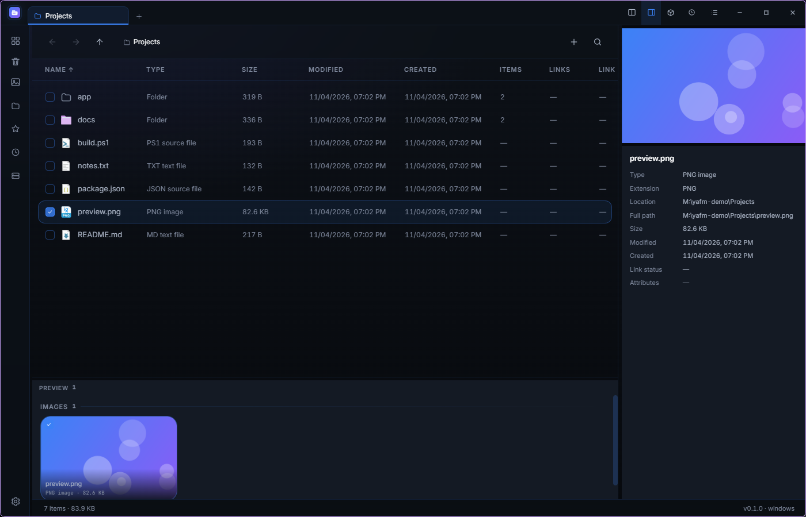
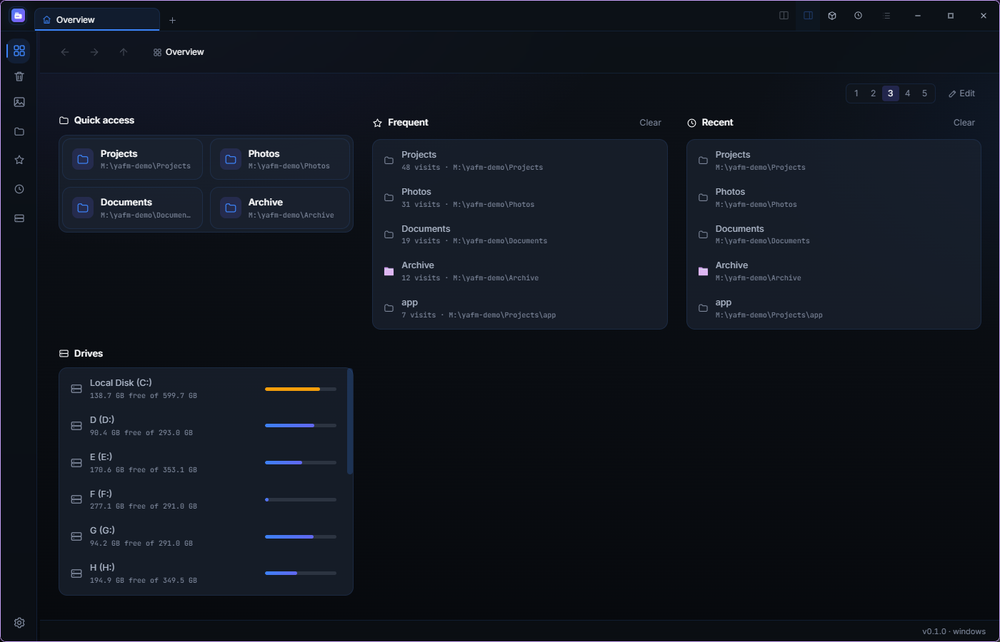
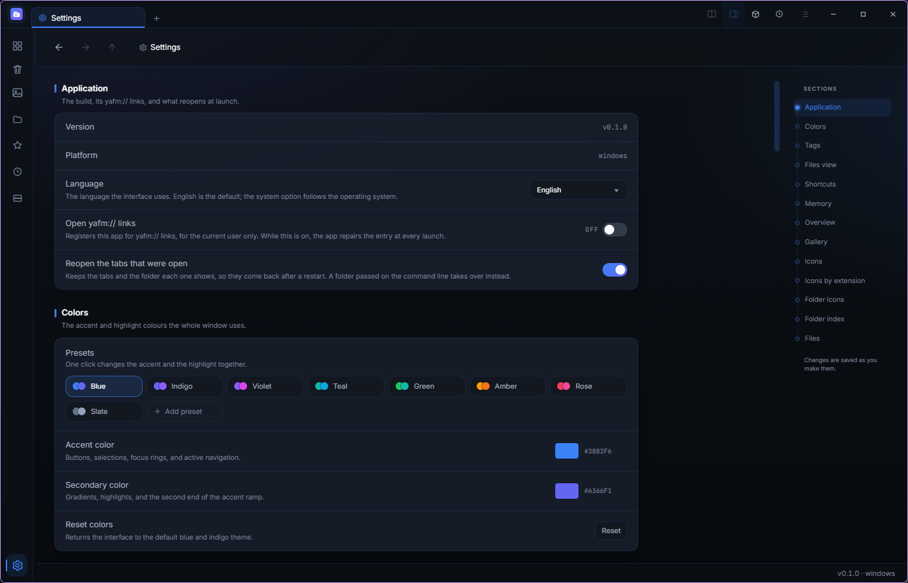

<div align="center">
  
  <h1>Yet Another File Manager</h1>
  <p><strong>把所有東西放進一個視窗的檔案管理員。</strong></p>
  <p>
    <a href="https://t2penbix99wcoxkv3a4g.github.io/Yet-Another-File-Manager/">網站</a> ·
    <a href="https://t2penbix99wcoxkv3a4g.github.io/Yet-Another-File-Manager/#/docs/Getting-Started">文件</a>
  </p>
  <p>
    <a href="README.md">English</a> ·
    <a href="README.ja.md">日本語</a> ·
    <a href="README.zh-CN.md">简体中文</a>
  </p>
</div>

分頁、壓縮檔、標籤與相簿都在同一個視窗裡的桌面檔案管理員。

<div align="center">
  <a href="docs/main-window.png"></a>
  <br>
  <em>主視窗，含詳細資料面板</em>
  <br><br>
  <a href="docs/overview.png"></a>
  <br>
  <em>概覽</em>
  <br><br>
  <a href="docs/settings.png"></a>
  <br>
  <em>設定：配色預設集與區段清單</em>
</div>

## 其他軟體沒有的

- **分割檢視** — 多個資料夾以分頁開啟，兩個並排顯示；每個分頁有自己的歷史記錄。
- **概覽** — 由面板組成的首頁：快速存取、常用、最近、磁碟機、共享、收藏與任意資料夾，一到五欄。
- **標籤** — 只有一個全域目錄：在任何資料夾裡都能給檔案與資料夾加標籤，每個標籤一種顏色；改名或
  改色會一次套用到所有資料夾。
- **相簿** — 把指定資料夾裡的圖片依日期分組，雙擊即可原尺寸檢視。
- **壓縮檔** — 把 ZIP、7z、RAR、TAR 與 7-Zip 能讀的格式當成資料夾開啟，分割與加密的也一樣；建立
  ZIP、7z、TAR 時可指定 AES 與分割，ZIP 還可選擇壓縮方式。
- **分享** — 把資料夾提供給已配對的裝置，或同一網路中的任何瀏覽器。
- **資源回收筒** — 還原、永久刪除，還能看到其他使用者的資源回收筒裡剩下的東西。
- **操作歷史** — 狀態中心列出這次工作階段做過的動作，任何一筆都能復原。
- **檔案托盤** — 用來暫放馬上要貼上的東西的架子：可以把任何資料夾裡選取的項目拖上去，它也會同步系統
  剪貼簿，其他應用程式裡複製的內容同樣會出現在這裡。
- **搜尋** — 區分大小寫、正規表示式，輸入時把其餘項目變淡或隱藏。
- **給指令碼用的選擇器** — 用 `yafm --pick-folder` / `--pick-file` 取代系統對話框。
- **速度** — 每個資料夾的小型索引（或一個中央資料庫）、延遲載入的圖示，以及處理批次工作的 Rust
  輔助程式。

## 用了什麼

- **C# / .NET 11** — 檔案操作、Shell 整合、資源回收筒、圖示、SQLite 索引與托盤圖示。
- **React 19 + TypeScript**（ **Vite**、 **styled-components**） — 介面。只負責顯示，透過 JSON 訊息與
  C# 端溝通。
- **Photino.NET** — 桌面外殼。Web 檢視來自系統：Windows 用 WebView2，Linux 用 WebKitGTK。
- **Rust**（`Native/yafm-native`） — 相簿掃描、建立壓縮檔（ZIP 與 7z）、量測與刪除目錄樹。它是建置的
  一部分：沒有 cargo 建置會停止，缺少函式庫應用程式無法啟動。

## 安裝

發佈版本自帶 .NET 執行階段，除了 Web 檢視（以及 Linux 的托盤函式庫）外不需要安裝其他東西。

| 檔案                                          | 適用                                                            |
|-----------------------------------------------|-----------------------------------------------------------------|
| `YetAnotherFileManager-<version>-win-x64.msi` | Windows（以使用者為單位，免管理員權限）                         |
| `yafm-<version>-1.fcXX.x86_64.rpm`            | Fedora — `sudo dnf install ./yafm-<version>-*.rpm`              |
| `yafm_<version>_amd64.deb`                    | Debian / Ubuntu — `sudo apt install ./yafm_<version>_amd64.deb` |
| `yafm-<version>-1-x86_64.pkg.tar.zst`         | Arch — `sudo pacman -U yafm-<version>-1-x86_64.pkg.tar.zst`     |

Windows 10/11 內建 WebView2；建置沒有程式碼簽章，第一次執行時 SmartScreen 可能提示一次。Linux 需要
WebKitGTK 4.1 與 libnotify，目前測試於 Fedora + KDE Plasma（Wayland）。剪貼簿在 Wayland 使用
wl-clipboard，在 X11 使用 xclip。

指令碼可以用同一個選擇器取代系統對話框：

```bash
yafm --pick-folder [--multiple] [--initial <path>] [--output <file>]
yafm --pick-file --filter "*.png;*.jpg" [--multiple] [--initial <path>] [--output <file>]
```

選取的路徑會逐行輸出到標準輸出；取消時結束碼為 `1`。

## 建置

```bash
git clone https://github.com/T2PeNBiX99wcoxKv3A4g/Yet-Another-File-Manager.git
cd YetAnotherFileManager
dotnet build YetAnotherFileManager/YetAnotherFileManager.csproj   # 同時會執行 cargo
```

介面是獨立的 Vite 專案：

```bash
cd YetAnotherFileManager/UserInterface
npm install
npm run build     # 輸出到 Resources/wwwroot，Release 建置會使用它
npm run dev       # Debug 建置連接這裡: http://127.0.0.1:3100
```

cargo 是必要的，缺少時建置會停止。網站與文件在 `Site`：

```bash
cd Site
npm install
npm run dev
```

## 致謝

- [Sigma File Manager](https://github.com/aleksey-hoffman/sigma-file-manager)（Aleksey Hoffman） —
  早期版面與功能組成的參考。

## 授權

MIT — 見 [LICENSE](LICENSE)。
